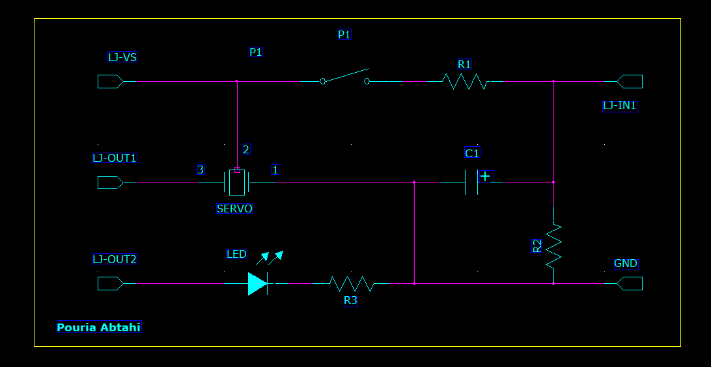
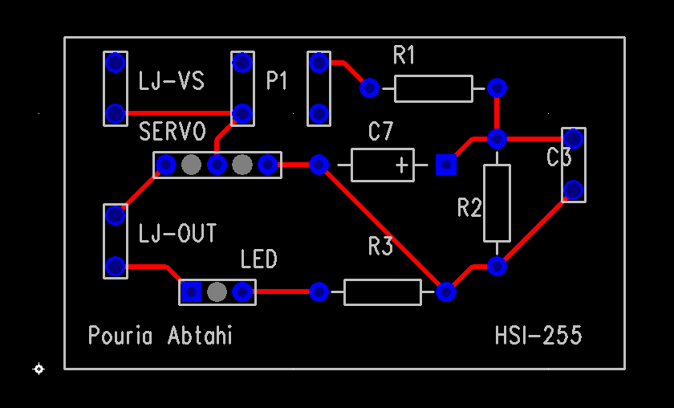

# Capacitor-Threshold Servo & LED Controller: LabJack U3-HV

A small hardware/software system: a C program running on a PC talks to a **LabJack U3-HV** DAQ over USB. It reads a capacitor's voltage on an analog input and drives a **servo motor (PWM)** and an **LED** once a user-set threshold is crossed. I also designed a custom **PCB** for the circuit in PADS.

Project for **HSI255 Hardware/Software Interfacing**, Computer Engineering Technology, Seneca Polytechnic (Winter 2023). Individual project.

**Skills shown:** C · data acquisition (analog in, digital out, timer/PWM) · servo PWM timing · RC circuit design · schematic capture and PCB layout (PADS) · Gerber/drill output · BOM costing

| Schematic | PCB layout |
|---|---|
|  |  |

---

## How it works

1. At start-up the servo is parked at one end (0°) and the LED is off.
2. The user enters a **threshold voltage** (0.1 to 4.45 V) and an **exit strategy**: run for *N seconds*, or stop after *N servo activations*.
3. The program samples the capacitor on **AIN1** 10 times per second and prints the voltage.
4. Pressing the push-button charges the capacitor through R1. When it reaches the threshold, the servo moves to the middle (90°), the LED (FIO5) turns on, and the user is told.
5. When the capacitor discharges below the threshold through R2, the servo returns to 0° and the LED turns off.
6. When the exit condition is met, the outputs return to a safe state and the LabJack configuration is reset.

### PWM for the servo

The servo is driven from the LabJack's Timer0 on **FIO4** in 8-bit PWM mode:

- Timer clock = 1 MHz / 78 = 12.82 kHz
- 8-bit PWM period = 256 / 12.82 kHz ≈ 19.97 ms, which is **about 50 Hz**, the standard servo frame
- LabJack duty cycle = (65536 − value) / 65536
  - `63810` → 2.6 % → **≈ 0.53 ms** pulse → one end (0°)
  - `60621` → 7.5 % → **≈ 1.50 ms** pulse → centre (90°)

### Dealing with threshold chatter

Near the threshold the capacitor voltage hovers around the set point, which made the servo twitch back and forth. I fixed it with two things:

- **Edge detection.** The program only acts on a *below → above* transition (`previousState`), so one crossing counts as one activation.
- **Settling delay.** After each activation the program waits 200 ms so the voltage can move clear of the threshold before the next sample.

A cleaner fix would be **hysteresis**: separate on and off thresholds, for example V<sub>th</sub> and V<sub>th</sub> − 0.1 V. That is the first thing I'd add now.

## Hardware

| Ref | Part | Value / notes |
|---|---|---|
| R1 | Resistor | 8.2 kΩ, charge path from LabJack VS through the push-button |
| R2 | Resistor | 100 kΩ 0.1 %, discharge path; also limits current into the LabJack input |
| R3 | Resistor | 330 Ω, LED current limit |
| C1 | Electrolytic | 470 µF 10 V |
| P1 | Tactile switch | SPST-NO |
| n/a | Servo | 5 V, 9 g metal-gear |
| n/a | LED | red, 5 mm |
| n/a | Terminal blocks / header | 5 mm 2-pos ×2, 2.54 mm 3-pos |

Total component cost: **$12.28 CAD** (Digi-Key, 2023).

LabJack connections: `VS` (5 V supply), `AIN1` (capacitor voltage), `FIO4` (servo PWM), `FIO5` (LED), `GND`.

## Repository layout

```
src/servo_capacitor_control.c   the program
vs-project/                     Visual Studio 2019 solution (Win32)
hardware/pads/                  PADS Logic schematic (.sch) and PADS Layout board (.pcb)
hardware/gerber/                Gerber RS-274X + Excellon drill files sent for fabrication
docs/images/                    schematic and layout renders
```

## Building

Windows only (LabJack UD driver).

1. Install the [LabJack UD driver](https://labjack.com/pages/support?doc=/software-driver/installer-downloads/ud-library/). It installs `LabJackUD.h` and `LabJackUD.lib` under `C:\Program Files (x86)\LabJack\Drivers\`.
2. Open `vs-project/Project-HSI.sln` in Visual Studio and build **Debug | Win32**.

The source includes the LabJack header by its absolute install path, exactly as it was submitted.

## Known limitations

- The return codes from the LabJack calls (`lj_cue`) are stored but never checked. If the device is unplugged, the program carries on with stale readings.
- `scanf` input isn't validated, so non-numeric input loops forever.
- The push-button is purely analog (it charges the RC). The software can't tell a press from noise.
